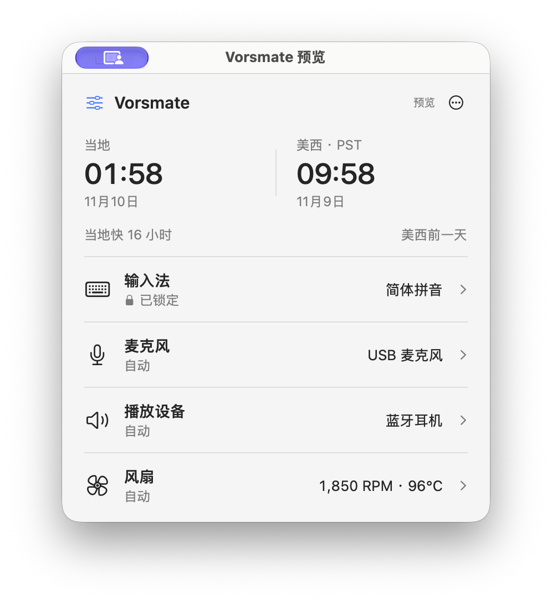
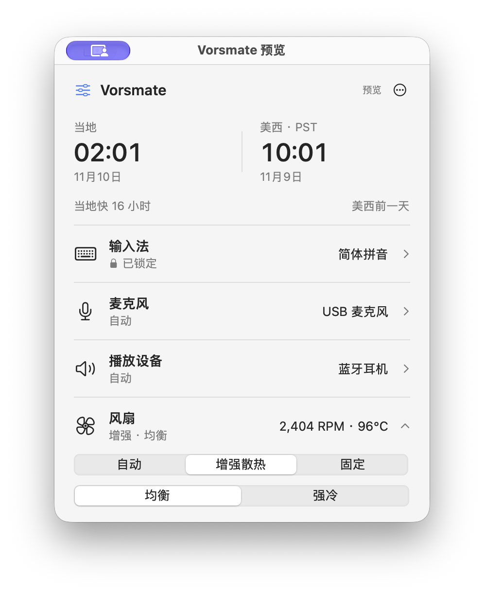

# Vorsmate

Input sources, audio devices, fan control, and time conversion in one compact Mac menu bar panel.

[简体中文](README.md) · English · [Download](https://github.com/0xTotoroX/vorsmate/releases) · [Issues](https://github.com/0xTotoroX/vorsmate/issues)

[](https://github.com/0xTotoroX/vorsmate/actions/workflows/ci.yml)
[](LICENSE)

 

Actual app screenshots using sample data. The app interface is currently in Simplified Chinese.

## Features

- **Input sources** — Switch quickly, lock a preferred input source, or select automatically by priority.
- **Audio devices** — Manage microphone and playback preferences independently. Fall back when a device disconnects and restore it when it returns.
- **Fan control** — System automatic, enhanced cooling, and fixed speed. Balanced and strong cooling use different response curves, with temperature smoothing and gradual cooldown.
- **Time comparison** — View local and US Pacific time side by side. Convert dates and times with daylight saving handled for both locations.

Built with SwiftUI and AppKit, with native Liquid Glass on macOS 26+. No account, audio recording, keystroke capture, or cloud service required.

## Download and install

Requires **macOS 14 or later**. The universal app includes Apple Silicon and Intel architectures.

1. Download `Vorsmate-0.1.0-universal.dmg` from [GitHub Releases](https://github.com/0xTotoroX/vorsmate/releases).
2. Open the disk image and drag **Vorsmate** into **Applications**.
3. Launch it from Applications and click the sliders icon in the menu bar.

**This is a preview release, signed with an Apple development certificate and not notarized.** If macOS blocks the first launch, verify the download source, then use **System Settings → Privacy & Security → Open Anyway**. See [Apple’s instructions](https://support.apple.com/en-us/102445). Do not disable Gatekeeper or System Integrity Protection. A SHA-256 checksum file is included with the download.

Fan control requires enabling the helper in the app and completing macOS authorization. Enhanced cooling is currently enabled only for the validated `Mac16,10` model. Other models retain system cooling; monitoring and fixed speed depend on hardware support. The Intel build has not been tested on Intel hardware. See [fan control](docs/fan-control.md) and [validation scope](docs/verification.md) for details.

## Usage

Click a feature row to expand its controls. The panel otherwise shows only the current state.

Input sources and audio channels each offer **Off**, **Automatic**, and **Locked** modes. Clicking a device selects and locks it. Use the priority controls to reorder preferences. Management is off on first launch; enable it where needed. Audio apps with their own device selection should use the system default. Input source locking does not control an input method’s internal language mode.

Fans default to system control. Enhanced cooling responds to sustained heat, slows gradually as temperatures drop, and returns control to macOS. Fixed mode maintains a chosen speed. Manual fan modes are not restored after restarting the app.

The left clock follows the Mac’s current time zone; the right shows US Pacific local time (PST / PDT). Click either clock to edit a date or use the slider to compare times. “Now” or closing the panel returns to the current time without changing the system time zone.

The panel closes when the pointer leaves; background management continues. Launch at login, About, and Quit are in the top-right menu.

## Build from source

Requires Xcode 26+ and the Swift 6 / macOS SDK.

```sh
git clone https://github.com/0xTotoroX/vorsmate.git
cd vorsmate
swift test
bash scripts/build.sh
open dist/Vorsmate.app
```

The default build targets the host architecture and uses an ad-hoc signature. Input source and audio management work; fans are monitored without control. To enable fan control in your own build, use an Apple signing certificate. General distribution also requires Developer ID signing and Apple notarization.

```sh
VORSMATE_SIGN_IDENTITY='certificate name or fingerprint' bash scripts/build.sh --universal
bash scripts/package.sh
```

Outputs are saved under `dist/`. These scripts do not install or publish the app. Run `open -n dist/Vorsmate.app --args --preview` for an isolated preview using sample data.

Issues and pull requests are welcome. Read the [contribution guide](CONTRIBUTING.md) and report security issues through the [security policy](SECURITY.md).

## License

[MIT License](LICENSE). Included third-party source and licenses are listed in [Third-party notices](THIRD_PARTY_NOTICES.md).
