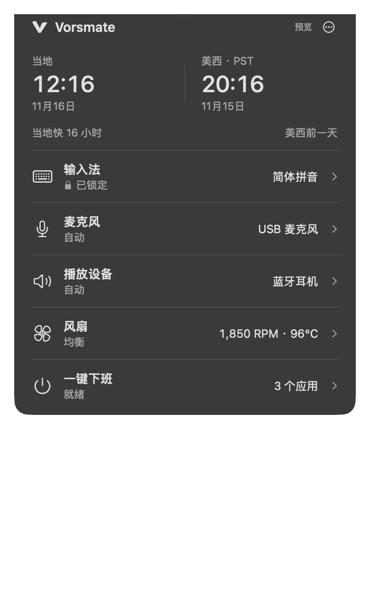
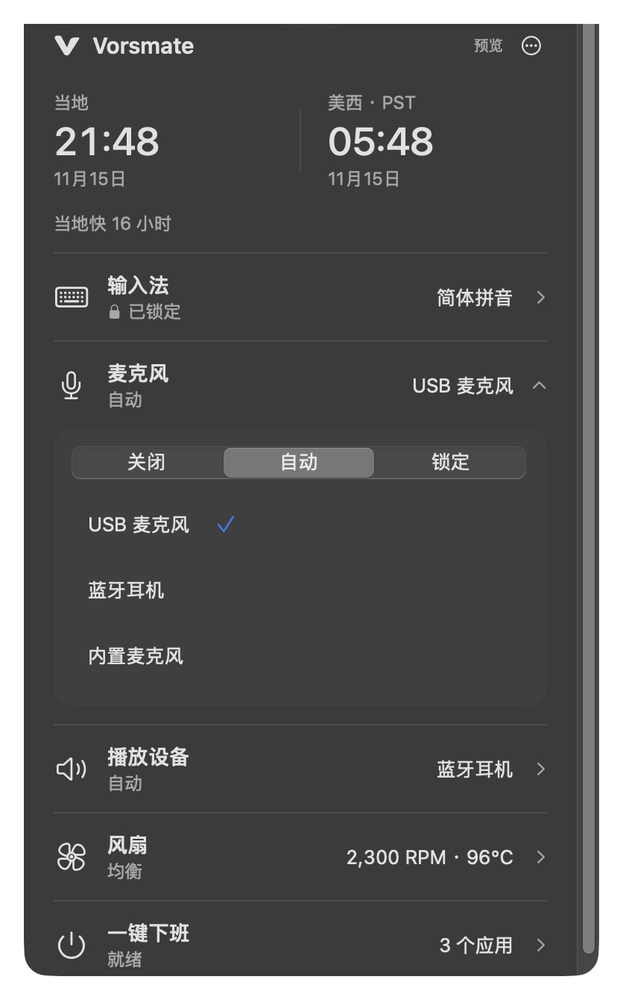
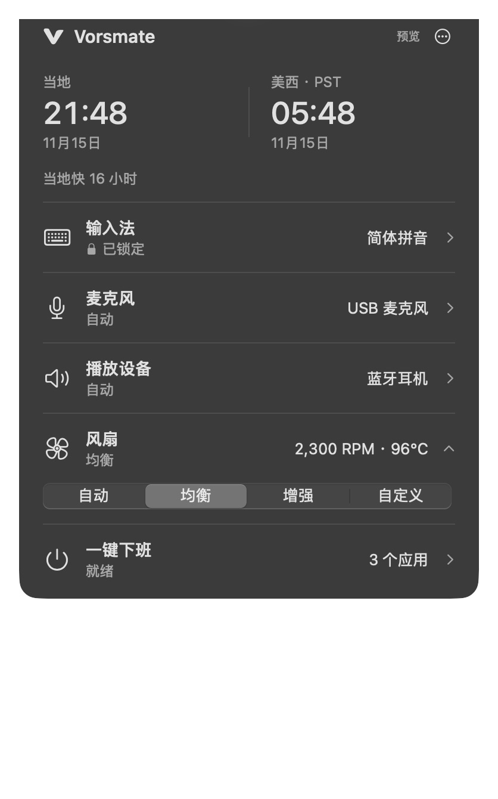

# Vorsmate

Input sources, audio devices, fan control, time conversion, and Quick Shutdown in one compact Mac menu bar panel.

[简体中文](README.md) · English · [Download](https://github.com/0xTotoroX/vorsmate/releases) · [Issues](https://github.com/0xTotoroX/vorsmate/issues)

[](https://github.com/0xTotoroX/vorsmate/actions/workflows/ci.yml)
[](LICENSE)

 

Actual app screenshots using sample data. Click to switch; drag to reorder in the same list. The app interface is currently in Simplified Chinese.

<details>
<summary>Fan controls</summary>



</details>

<details>
<summary>App updates</summary>


</details>

## Features

- **Input sources** — Switch quickly, lock a preferred input source, or drag to set priorities for automatic selection.
- **Audio devices** — Reorder and lock microphone and playback devices independently. Fall back when a device disconnects and restore it when it returns. Supported wireless receivers become eligible only when a transmitter connects.
- **Fan control** — Four direct choices: Automatic, Balanced, Enhanced, and Custom. Balanced and Enhanced smooth temperature changes and slow down gradually; Custom sets a fixed speed. Background readings refresh without interrupting the controls.
- **Quick Shutdown** — Clean up apps before shutting down or restarting, with a cancellable five-second countdown and per-app exclusions.
- **Modules** — Enable or disable all six modules independently; disabling stops their background work.
- **App updates** — Check a fixed signed feed and verify both the feed and installer. Clear timeout errors offer a retry while keeping your settings and fan helper authorization.
- **Time comparison** — View local and US Pacific time side by side. Convert dates and times with daylight saving handled for both locations.

Built with SwiftUI and AppKit, with native Liquid Glass on macOS 26+. No account, audio recording, keystroke capture, or cloud service required.

## Download and install

Requires **macOS 14 or later**. The universal app includes Apple Silicon and Intel architectures.

1. Download `Vorsmate-0.3.2.dmg` from [GitHub Releases](https://github.com/0xTotoroX/vorsmate/releases/tag/v0.3.2).
2. Open the disk image and drag **Vorsmate** into **Applications**.
3. Launch it from Applications and click the **V** icon in the menu bar.

**Upgrading from v0.3.2 or earlier:** These versions use the old installer naming rule. Install the next release manually from GitHub Releases; that release includes the new rule for subsequent in-app updates. Existing settings and fan helper authorization are retained.

## Usage

Click a feature row to expand its controls. The panel otherwise shows only the current state.

Input sources and audio channels each offer **Off**, **Automatic**, and **Locked** modes. In the same expanded list, click an item to select and lock it, or drag a row immediately to reorder priorities—no long press required. Other rows smoothly make room. Items higher in the list take priority; the order is saved when you drop. Management is off on first launch; enable it where needed. Audio apps with their own device selection should use the system default. Input source locking does not control an input method’s internal language mode.

Rows lift slightly while dragging and settle with a soft spring. Drop outside the list or press Esc to cancel, keeping the original order and lock target. Keyboard and accessibility actions are also available.

For supported wireless microphones, availability follows the transmitter connection. A receiver alone does not take over the input; connecting a transmitter restores priority selection, and disconnecting all transmitters triggers fallback. Muting, input level, and pauses in speech do not trigger switching. Locks are preserved while a backup is used until the transmitter reconnects. See [supported devices and limitations](docs/wireless-microphones.md).

After a temporary switching failure, Vorsmate waits and rechecks automatically. Your lock or priority rules resume once the state recovers; a warning appears only if the problem persists.

Fans offer four parallel choices: Automatic, Balanced, Enhanced, and Custom. Automatic uses system control. Balanced and Enhanced respond to sustained heat, slow gradually as temperatures drop, and return control to macOS; Enhanced starts earlier and runs faster. Custom maintains a chosen speed. The last three choices are saved and restored on startup and wake when the helper is authorized and no competing fan tool is running. Sleep, app exit, and module disable return control to macOS while retaining saved profiles; choosing Automatic clears them. Hidden, idle monitoring pauses the main-process polling timer.

The left clock follows the Mac’s current time zone; the right shows US Pacific local time (PST / PDT). Click either clock to edit a date or use the slider to compare times. “Now” or closing the panel returns to the current time without changing the system time zone.

Open Quick Shutdown in the menu bar to choose which apps to quit in advance. With more than six apps, search and select the matching results together. Shut Down and Restart start a five-second countdown. Cancel, Escape, Back, or closing the panel cancels it. Force Quit is enabled by default and can discard unsaved work. Turn it off in Options to stop if an app is still running. macOS handles unselected or newly opened apps at shutdown or restart. The enabled helper releases the fans before submitting the request. Without the helper, Vorsmate uses System Events and may need automation permission. Preview uses simulated apps.

The panel closes when the pointer leaves; background management continues. The top-right menu contains independent switches for all six modules, Launch at Login, Check for Updates, About, and Quit.

The optional Xiaomi remote plugin is off by default. Place the built `VorsmateRemote.app` beside `Vorsmate.app` and enable the remote in the modules menu to configure per-app shortcuts and hold-to-repeat. Voice input requires an existing MiRemoteV 2ch virtual audio device. [Remote setup and key migration (Chinese)](docs/remote.md)

Updates are checked one minute after startup and every 12 hours, or manually through the top-right menu. You confirm downloading and restarting. Checks time out after 20 seconds; downloads with no progress for 60 seconds and preparation exceeding 120 seconds stop waiting and offer a retry. Installation itself is never interrupted by a timer. Both the feed and installer require valid signatures. See [update behavior and publishing](docs/updates.md).

## Build from source

Requires Xcode 26+ and the Swift 6 / macOS SDK.

```sh
git clone https://github.com/0xTotoroX/vorsmate.git
cd vorsmate
swift test
bash scripts/dev.sh
```

The default build targets the host architecture and uses an ad-hoc signature. Input source and audio management work; fans are monitored without control. To enable fan control in your own build, use an Apple signing certificate. General distribution also requires Developer ID signing and Apple notarization.

```sh
VORSMATE_SIGN_IDENTITY='certificate name or fingerprint' bash scripts/build.sh --universal
bash scripts/package.sh
```

The release build goes to `dist/`. For daily use, quit any previous copy once. Each `bash scripts/dev.sh` then rebuilds and relaunches the development app with your existing preferences. To package an approved version tag separately, run `bash scripts/prepare-release.sh vX.Y.Z`. See the [development guide](CONTRIBUTING.md#本地开发).

Issues and pull requests are welcome. Read the [contribution guide](CONTRIBUTING.md) and report security issues through the [security policy](SECURITY.md).

## License

[MIT License](LICENSE). Included third-party source and licenses are listed in [Third-party notices](THIRD_PARTY_NOTICES.md).
