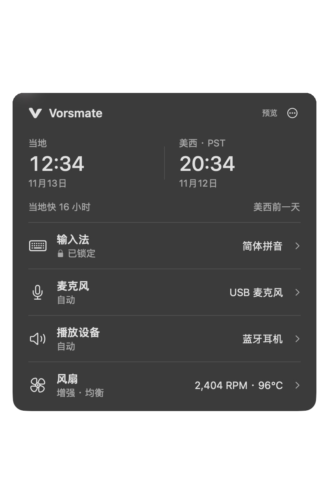
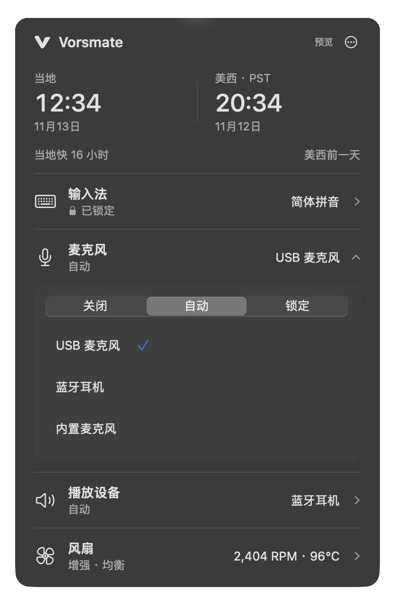
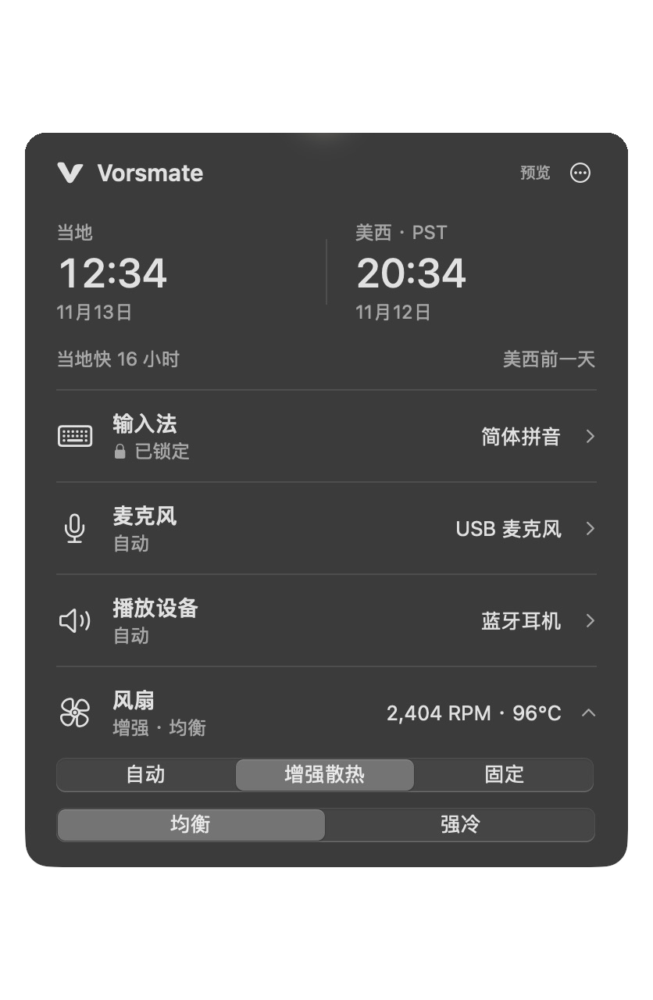

# Vorsmate

把输入法、音频设备、风扇和时间对照，收进一个简洁的 Mac 菜单栏面板。

简体中文 · [English](README.en.md) · [下载](https://github.com/0xTotoroX/vorsmate/releases) · [问题反馈](https://github.com/0xTotoroX/vorsmate/issues)

[](https://github.com/0xTotoroX/vorsmate/actions/workflows/ci.yml)
[](LICENSE)

 

实际应用界面，使用演示数据。同一列表，点击切换，拖动排序。

<details>
<summary>风扇控制界面</summary>



</details>

## 功能

- **输入法管理**：快速切换、锁定输入源，或拖动排序后按优先级自动选择。
- **音频管理**：麦克风与播放设备分别排序、分别锁定。设备断开时回退，重连后恢复。支持的无线接收器在发射器连接后才参与选择。
- **风扇控制**：系统自动、增强散热和固定转速。均衡与强冷采用不同响应，配合温度平滑和缓降。
- **时间对照**：并排查看当地与美西时间，点击即可换算日期与时刻，自动处理两地夏令时。

原生 SwiftUI / AppKit 界面，macOS 26+ 使用系统 Liquid Glass。无需账号，不录音、不读取键盘内容，不依赖云服务。

## 下载安装

需要 **macOS 14 或更新版本**。安装包包含 Apple Silicon 与 Intel 两种架构；应用界面目前为简体中文。

1. 在 [GitHub Releases](https://github.com/0xTotoroX/vorsmate/releases/tag/v0.2.0) 下载 `Vorsmate-0.2.0-universal.dmg`。
2. 打开磁盘镜像，将 **Vorsmate** 拖入 **Applications**。
3. 从“应用程序”中启动，点击菜单栏的 **V** 图标。

**当前为预览版，使用 Apple 开发签名，尚未公证。** 若首次启动被 macOS 阻止，核对下载来源后，在“系统设置 → 隐私与安全性 → 仍要打开”确认。[Apple 的说明](https://support.apple.com/zh-cn/102445)。无需关闭 Gatekeeper 或系统完整性保护。下载页附有 SHA-256 校验文件。

风扇调速需在应用中启用助手并完成系统授权。增强散热目前仅支持已核验的 `Mac16,10`；其他机型保持系统调速，监控与固定转速取决于硬件支持。Intel 架构已构建，尚未完成 Intel 实机验收。详见[风扇说明](docs/fan-control.md)与[验证范围](docs/verification.md)。

## 使用

点功能行展开操作，再次点击即可收起；平时只显示当前状态。

输入法和音频各自有三种模式：**关闭**停止管理，**自动**按优先级选择，**锁定**保持指定项目。展开后的同一份列表中，点击项目切换并锁定，直接拖动整行调整优先级，无需长按，越靠上越优先；其他项目平滑让位，松手自动保存。首次启动默认关闭，按需开启。音频应用如单独指定了设备，需在该应用中选择“系统默认”。输入法锁定针对系统输入源，不改变输入法内部的中英文状态。

拖动采用柔和吸附：项目轻微抬起，松手自然落位。拖出列表或按 Esc 取消排序，优先级和锁定目标保持原样；也支持键盘与辅助功能操作。

支持的无线麦克风以发射器连接状态判断是否可用：只插接收器时使用备用麦，发射器连上后按优先级切换，全部断开时回退。静音、音量和说话停顿不触发切换；手动锁定的设备未就绪时先用备用，连接后恢复。当前支持范围与状态提示见[无线麦说明](docs/wireless-microphones.md)。

短暂切换异常时会先冷却、自动复查，恢复正常后继续原锁定或优先级；只有异常持续才显示提示。

风扇默认由系统管理。选择增强散热后，持续升温才加速，降温后缓慢回落并交还系统；固定模式保持指定转速。手动风扇模式不跨应用重启保存。

左侧时钟跟随 Mac 当前时区，右侧为美西当地时间（PST / PDT）。点击任一时钟编辑日期、拖动滑杆换算；“现在”或关闭面板恢复实时时间，不修改系统时区。

鼠标离开面板后自动收起，后台管理继续。登录时启动、关于和退出位于右上角菜单。

## 从源码构建

需要 Xcode 26+ 与 Swift 6 / macOS SDK。

```sh
git clone https://github.com/0xTotoroX/vorsmate.git
cd vorsmate
swift test
bash scripts/build.sh
open dist/Vorsmate.app
```

默认构建本机架构并使用临时签名，支持输入法、音频与风扇监控。自行启用风扇调速，需要自己的 Apple 签名证书；正式分发还需要 Developer ID 与 Apple 公证。

```sh
VORSMATE_SIGN_IDENTITY='证书名称或指纹' bash scripts/build.sh --universal
bash scripts/package.sh
```

产物位于 `dist/`，脚本不会安装或发布。开发时可用 `open -n dist/Vorsmate.app --args --preview` 打开只使用演示数据的隔离预览。

欢迎提交 Issue 和 PR。开发约定见[贡献说明](CONTRIBUTING.md)，安全问题见[安全报告](SECURITY.md)。

## 许可

[MIT License](LICENSE)。实际使用的第三方源码及许可见[第三方通知](THIRD_PARTY_NOTICES.md)。
