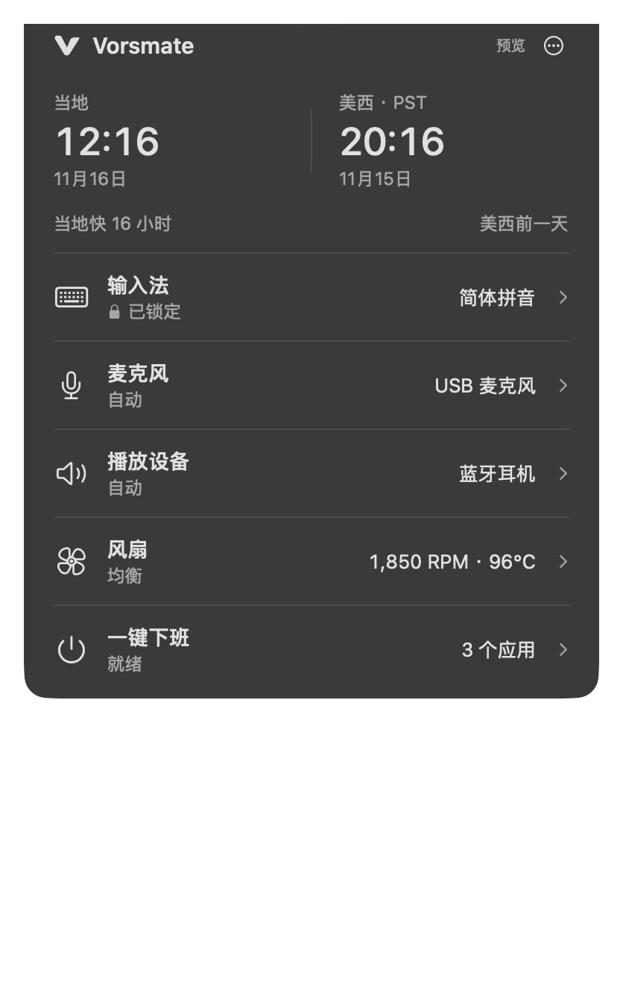
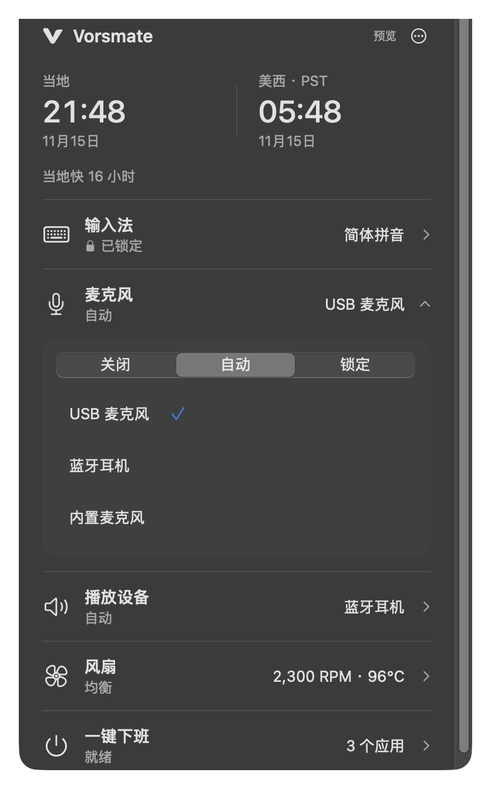
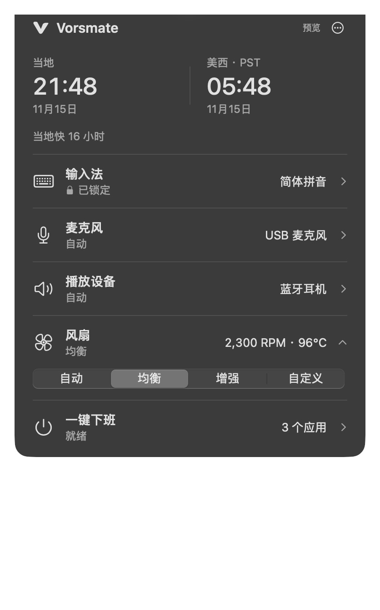
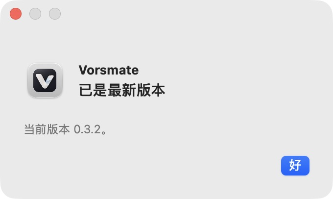

# Vorsmate

把输入法、音频设备、风扇、时间对照和一键下班，收进一个简洁的 Mac 菜单栏面板。

简体中文 · [English](README.en.md) · [下载](https://github.com/0xTotoroX/vorsmate/releases) · [问题反馈](https://github.com/0xTotoroX/vorsmate/issues)

[](https://github.com/0xTotoroX/vorsmate/actions/workflows/ci.yml)
[](LICENSE)

 

实际应用界面，使用演示数据。同一列表，点击切换，拖动排序。

<details>
<summary>风扇控制界面</summary>



</details>

<details>
<summary>应用更新界面</summary>



</details>

## 功能

- **输入法管理**：快速切换、锁定输入源，或拖动排序后按优先级自动选择。
- **音频管理**：麦克风与播放设备分别排序、分别锁定。设备断开时回退，重连后恢复。支持的无线接收器在发射器连接后才参与选择。
- **风扇控制**：自动、均衡、增强、自定义四项直接选择。均衡与增强配合温度平滑和缓降，自定义调节固定转速；后台刷新读数不打断操作。
- **一键下班**：清理应用后关机或重启，五秒内可取消；可跳过应用、选择强制退出和禁止下次恢复窗口。
- **功能模块**：六个模块独立开关，关闭即停止相应后台工作。
- **应用更新**：从固定签名源检查新版本，验证更新描述与安装包；等待超时会明确提示，可直接重试，保留配置与风扇助手授权。
- **时间对照**：并排查看当地与美西时间，点击即可换算日期与时刻，自动处理两地夏令时。

原生 SwiftUI / AppKit 界面，macOS 26+ 使用系统 Liquid Glass。无需账号，不录音、不读取键盘内容，不依赖云服务。

## 下载安装

需要 **macOS 14 或更新版本**。安装包包含 Apple Silicon 与 Intel 两种架构；应用界面目前为简体中文。

1. 在 [GitHub Releases](https://github.com/0xTotoroX/vorsmate/releases/tag/v0.3.2) 下载 `Vorsmate-0.3.2.dmg`。
2. 打开磁盘镜像，将 **Vorsmate** 拖入 **Applications**。
3. 从“应用程序”中启动，点击菜单栏的 **V** 图标。

**升级说明**：v0.3.2 及更早版本仍使用旧文件名规则，下一次升级请从 Releases 手动安装新版。新规则随下一版生效，后续可继续应用内更新；现有配置和风扇助手授权保留。

## 使用

点功能行展开操作，再次点击即可收起；平时只显示当前状态。

输入法和音频各自有三种模式：**关闭**停止管理，**自动**按优先级选择，**锁定**保持指定项目。展开后的同一份列表中，点击项目切换并锁定，直接拖动整行调整优先级，无需长按，越靠上越优先；其他项目平滑让位，松手自动保存。首次启动默认关闭，按需开启。音频应用如单独指定了设备，需在该应用中选择“系统默认”。输入法锁定针对系统输入源，不改变输入法内部的中英文状态。

拖动采用柔和吸附：项目轻微抬起，松手自然落位。拖出列表或按 Esc 取消排序，优先级和锁定目标保持原样；也支持键盘与辅助功能操作。

支持的无线麦克风以发射器连接状态判断是否可用：只插接收器时使用备用麦，发射器连上后按优先级切换，全部断开时回退。静音、音量和说话停顿不触发切换；手动锁定的设备未就绪时先用备用，连接后恢复。当前支持范围与状态提示见[无线麦说明](docs/wireless-microphones.md)。

短暂切换异常时会先冷却、自动复查，恢复正常后继续原锁定或优先级；只有异常持续才显示提示。

风扇有自动、均衡、增强、自定义四个并列选项。自动由系统管理；均衡与增强在持续升温后加速，增强更早、更强，降温后缓慢回落并交还系统；自定义保持指定转速。后三项会保存；助手已授权且无竞争工具时，启动和睡眠唤醒自动恢复。睡眠、停用模块与退出先交回系统，保留档位；切回自动才清除保存档位。面板隐藏且没有调速任务时暂停主进程风扇轮询。

左侧时钟跟随 Mac 当前时区，右侧为美西当地时间（PST / PDT）。点击任一时钟编辑日期、拖动滑杆换算；“现在”或关闭面板恢复实时时间，不修改系统时区。

在菜单栏点「一键下班」选择提前退出的应用。应用超过六个时可以搜索，并对结果批量勾选。关机或重启有五秒倒计时，点击取消、按 Esc、返回或收起面板均可撤销。默认启用强制退出，可能丢失未保存的更改；在「选项」关闭后，仍在运行的应用会阻止本次操作。未选中或稍后打开的应用由 macOS 在关机或重启时处理。已启用的助手先释放风扇再提交系统请求；无助手时通过 System Events 请求，可能需要系统自动化授权。预览使用模拟应用。

鼠标离开面板后自动收起，后台管理继续。右上角「功能模块」可分别启停时间、输入法、麦克风、播放设备、风扇与一键下班，全部默认启用；关闭风扇会归还系统控制，关闭设备模块会停止监听。登录时启动、检查更新、关于和退出也位于该菜单。

另有默认关闭的小米遥控器插件。将构建出的 `VorsmateRemote.app` 与 `Vorsmate.app` 放在同一目录，在「功能模块」开启「遥控器」，即可在菜单栏为不同应用设置按键和连发。遥控器收音需要本机已有 MiRemoteV 2ch 虚拟音频设备。[按键迁移与收音说明](docs/remote.md)

应用在启动一分钟后及每 12 小时检查更新，也可在右上角菜单点「检查更新」。发现新版后由你确认下载和重启；检查最长等待 20 秒，下载无进展 60 秒、准备超过 120 秒会结束等待并提供重试。实际安装不会被计时器中断。更新说明和安装包均需通过签名验证，详见[应用更新](docs/updates.md)。

## 从源码构建

需要 Xcode 26+ 与 Swift 6 / macOS SDK。

```sh
git clone https://github.com/0xTotoroX/vorsmate.git
cd vorsmate
swift test
bash scripts/dev.sh
```

默认构建本机架构并使用临时签名，支持输入法、音频与风扇监控。自行启用风扇调速，需要自己的 Apple 签名证书；正式分发还需要 Developer ID 与 Apple 公证。

```sh
VORSMATE_SIGN_IDENTITY='证书名称或指纹' bash scripts/build.sh --universal
bash scripts/package.sh
```

正式构建产物位于 `dist/`。首次切入开发版前，先退出旧实例。之后每轮开发使用同一条启动命令。开发版沿用现有配置和真实设备，也可单独构建模拟预览。用法与签名差异见[本地开发](CONTRIBUTING.md#本地开发)。

欢迎提交 Issue 和 PR。开发约定见[贡献说明](CONTRIBUTING.md)，安全问题见[安全报告](SECURITY.md)。

## 许可

[MIT License](LICENSE)。实际使用的第三方源码及许可见[第三方通知](THIRD_PARTY_NOTICES.md)。
